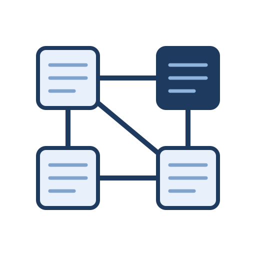

<div align="center">



# DSM

**Memoria compartida distribuida sobre Linux.**

Varios procesos independientes aportan memoria física a un espacio global y proyectan la
misma vista virtual. La aplicación usa punteros normales: cuando toca una página que no
tiene, el acceso falla y el sistema la trae por TCP sin que el programa lo note.

[Inicio rápido](#inicio-rápido) · [Cómo funciona](#cómo-funciona) · [API](docs/API.md)

</div>

---

## Inicio rápido

```sh
git clone https://github.com/mau671/dsm && cd dsm
make release
```

Arranca dos nodos en terminales distintas:

```sh
DSM_NODE_TAG=n1 ./build/bin/release/dsm dsm.conf   # terminal 1
DSM_NODE_TAG=n2 ./build/bin/release/dsm dsm.conf   # terminal 2
```

El primero asume la ranura 0 y el segundo lo descubre por TCP y se une. Cada nodo toma el
primer puerto libre del bloque 27600–27699.

### Nodos y clientes

Un proceso puede unirse al clúster de dos formas. Un **nodo** aporta memoria física y puede
ser custodio de páginas; un **cliente** usa la memoria del clúster sin aportar ninguna y
nunca es custodio. El rol se elige con `DSM_NODE_MODE`:

```sh
DSM_NODE_MODE=node   ./build/bin/release/dsm dsm.conf     # nodo (por defecto)
DSM_NODE_MODE=client ./build/bin/release/filtro_video ...  # cliente
```

Las aplicaciones de prueba se ejecutan siempre como cliente, de modo que lanzarlas no
agrega un nodo a la membresía. En `dsmctl nodes` aparecen en una fila aparte, marcadas como
`(cliente)`, y no suman al total de nodos ni a la memoria del clúster.

## Cómo funciona

Cada nodo reserva un `memfd` de 4 GiB y lo mapea dos veces: la **vista** que ve la
aplicación, con permisos por página, y un **alias** interno de lectura y escritura que usa
el código de red para instalar contenido sin tocar los permisos de la vista.

Cuando la aplicación toca una página que no tiene, `SIGSEGV` despierta al manejador, que
solo registra el fallo y duerme al hilo en un futex. Un despachador independiente resuelve
la página con el protocolo MSI, aplica el permiso correcto y despierta al hilo, que reintenta
la instrucción. El manejador nunca hace red ni toma locks: por eso el camino del fallo
siempre termina.

Cada página tiene un nodo custodio que guarda su entrada de directorio (quién tiene copia,
quién la tiene modificada, qué versión). El custodio se elige con un anillo de dispersión
consistente ponderado por la memoria que aporta cada nodo, así que todos llegan al mismo
resultado sin coordinador.

### Estados de coherencia

| Estado | Permiso en la vista | Significado |
| --- | --- | --- |
| `M` | `PROT_READ \| PROT_WRITE` | Copia exclusiva y modificable |
| `S` | `PROT_READ` | Copia de solo lectura compartida |
| `I` | `PROT_NONE` | Sin copia válida, dispara un fallo |

Hay tres estados transitorios (`IS_PEND`, `IM_PEND`, `SM_PEND`) que existen porque cada
transición espera una respuesta por red, y mientras se espera la página no tiene un estado
definitivo que describir.

## Uso

### Aplicaciones de prueba

Las aplicaciones son **clientes del clúster**: usan la memoria distribuida sin aportar
ninguna, así que ejecutarlas no agrega un nodo. Solo necesitan un clúster en marcha y
`dsm.conf` en el directorio actual (o `--conf <archivo>`).

```sh
# Filtro de blanco y negro sobre un video real (RGB24 → luminancia)
./build/bin/release/filtro_video datos/video_128x96.rgb /tmp/gris.gris 4

# Autómata de Conway sembrado con una fotografía real de 192 x 192
./build/bin/release/juego_vida --imagen datos/tablero_192.gray 192 192 30 4
./build/bin/release/juego_vida --imagen datos/tablero_192.gray --verificar 192 192 30 4
```

Los archivos de `datos/` son material real versionado en el repositorio, no datos
sintéticos generados al vuelo: un video y una fotografía convertidos con `ffmpeg`. Para
producir más, `video_pack` añade la cabecera que espera `filtro_video` a cualquier
secuencia RGB24 cruda.

```sh
./build/bin/release/filtro_video --generar /tmp/sintetico.rgb 640 480 30   # alternativa
./build/bin/release/juego_vida --patron glider 128 128 40 4                # patrón clásico
```

`--verificar` repite la simulación en memoria normal y compara el tablero final celda por
celda contra el que se ejecutó sobre DSM.

### Escribir una aplicación

```c
#include "dsm.h"
#include <string.h>

int main(void)
{
    if (dsm_init("dsm.conf", 0) != DSM_OK)
        return 1;

    /* Obligatorio en todo hilo que toque la vista compartida. */
    if (dsm_thread_attach() != DSM_OK) {
        dsm_finalize();
        return 1;
    }

    void *buf = NULL;
    if (dsm_alloc(64 * 1024 * 1024, &buf) == DSM_OK) {
        /* Los fallos de página se resuelven de forma transparente. */
        memset(buf, 0, 64 * 1024 * 1024);
        dsm_barrier(0, 2);   /* sincroniza con el otro nodo */
        dsm_free(buf, 64 * 1024 * 1024);
    }

    dsm_thread_detach();
    dsm_finalize();
    return 0;
}
```

### Diagnóstico

`dsmctl` consulta un nodo en ejecución sin unirse al clúster:

```sh
./build/bin/release/dsmctl stats
./build/bin/release/dsmctl nodes
./build/bin/release/dsmctl pages 0 16
```

## Compilar y probar

| Perfil | Contenido |
| --- | --- |
| `make release` | `-O2 -DNDEBUG` |
| `make debug` | `-g3 -O0`, incluye `test_basico` |
| `make asan` | AddressSanitizer + UBSan |
| `make tsan` | ThreadSanitizer |

Los cuatro perfiles comparten `-Wall -Wextra -Wpedantic -Werror` y se organizan en
`build/{bin,lib,obj}/<perfil>/`.

```sh
make test-unit   # 12 suites de módulo, bajo ASan+UBSan
make test-e2e    # dos procesos reales por la API pública
```

## Estructura

```
include/     cabeceras; dsm.h es la única que una aplicación necesita
src/         núcleo: config, wire, net, util, discovery, mem, msi, ring, sigsegv, sync, worker
apps/        dsm (nodo), test_basico, filtro_video, juego_vida
tools/       dsmctl y video_pack
tests/       unit/ (12 suites) y e2e/
docs/        API.md e informes compilados
datos/       video y fotografía reales para las aplicaciones de prueba
```

## Documentación

- [API pública](docs/API.md) — firmas, parámetros, errores y estado de cada función.
- [Aplicaciones de prueba](docs/Aplicaciones_de_prueba.md) — diseño, ejecución y resultados medidos.
- [Informe del entregable](docs/Entregable02/) — arquitectura, protocolo, coherencia MSI y resultados.

## Requisitos

Linux con `memfd_create(2)` (kernel 3.17 o superior), `gcc` con C11, `pthreads` y `make`.
La vista se proyecta en `0x200000000000`, así que `vm.mmap_min_addr` debe dejar esa región
libre.

## Licencia

MIT — Mauricio González Prendas y Samuel Durán Maroto. Ver [LICENSE](LICENSE).
